**Abstract:** Image encryption methods aim to protect content privacy. Typically, they encompass scrambling and diffusion. Every pixel of the image is permuted (scrambling) and its value is transformed according to a key (diffusion). Although several methods have been proposed in the literature, some of them have been cryptanalyzed. In this paper, we present a novel method that deviates the traditional schemes. We use variable length codes based on Collatz conjecture for transforming the content of the image into non-intelligible audio; therefore, scrambling and diffusion processes are performed simultaneously in a non-linear way. With our method, different ciphered audio is obtained every time, and it depends exclusively on the selected key (the size of the key space equal to $8.57 \times 10^{506}$). Several tests were performed in order to analyze randomness of the ciphered audio signals and the sensitivity of the key. Firstly, it was found that entropy and the level of disorder of ciphered audio signals are very close to the maximum value of randomness. Secondly, fractal behavior was detected into scatter plots of adjacent samples, altering completely the behavior of natural images. Finally, if the key was slightly modified, the image could not be recovered. With the above results, it was concluded that our method is very useful in image privacy protection applications.

**Keywords:** image encryption; Collatz conjecture; ciphered audio; scrambling; diffusion

---

# Introduction

Nowadays, the amount of information posted on public sites or transmitted by digital form is huge. For example, the quantity of image uploads every day on Facebook is higher than three hundred million. Most times, the images are not content-sensitive, so it is not important if they are public; however, in other cases, the owner can wish to protect the privacy of its content. One way to provide privacy to images is through an encryption scheme [1], which has the objective of transforming the (secret) image to an unintelligible form to mask its perceptual content. The posted image can look like a noisy image, and only the authorized destination user can reveal the secret content.

In general, an encryption process encompasses two parts, the first one is related to a permutation task (confusion) and the second one to diffusion [2,3]. The aim of the first stage is to place out every pixel of the image in another position, whereas its value is changed in the diffusion process. For image encryption, the combination of both processes in a non-linear way is highly recommended [4,5]. With the above conditions, it is expected that the ciphered image has the appearance of random noise, and thus its content is completely masked.

In the last several years, chaotic sequences have been widely used [7–12]. G. Ye in 2010 [7] proposed an image scrambling encryption algorithm based on permutations of the pixel binary values in the image, by columns and rows, according to a chaotic sequence. Huang in 2011 [8] used the Chebyshev generator to obtain an encryption algorithm with only one permutation process and one diffusion process. Wang, Teng, and Qin in 2012 [9] developed a color image encryption algorithm based on a chaos system to encrypt the three components: R, G, and B simultaneously, with a low time-complexity. Zhou, Bao, and Chen in 2014 [10] proposed a new 1D chaotic system to combine with other chaotic maps (e.g., Logistic, Tent) for obtaining an algorithm with better performance in terms of chaos. Ye and Huang in 2016 [11] proposed an image encryption scheme that combines the chaotic sequence with the electrocardiography (ECG) signals of the user. Pak and Huang in 2017 [12] used a combination of 1D chaotic maps to encrypt color images; their method has a high-level of security and it is fast.

Although the above methods reached good performance, some of them have been broken [13–19]. Tu, Liao, and Xiang in 2013 [13] used the chosen-plaintext attack to recover the equivalent key and the original image from the encrypted image, for the method presented in [9]. Wang, Luan, and Bao [14] in 2014 carried out the chosen-plaintext attack to the method of [8]. C. Li, D. Lin and J. Lü in 2017 [17] proposed an efficient known-plaintext attack and a general chosen-plaintext attack on the algorithm ISEA of the method in [7]. In a similar way, Dhall et al. in 2018 [15] demonstrated that differential cryptanalysis with linear equations allows one to discover the original images for the method proposed by [10]. Wang et al. [16] in 2018 broke the method proposed by [12]. C. Li, D. Lin, J. Lü, and F. Hao [18] recently published a summary of security defects of the algorithm proposed in [11]. Finally, Erick Yong Xie et al. in 2017 [19] provided some bases for further optimizing the attack on one of the well-known image encryption methods titled Fridrich's scheme.

A second group of image encryption methods includes deoxyribonucleic acid (DNA) encoding before the process of scrambling and ciphering [20,21]. In terms of the randomness of the encrypted image, the results are similar to that obtained by chaotic sequences, and again this kind of method has been cryptanalyzed (e.g., [22]). Alternative solutions use cellular automata to perform the confusion and diffusion tasks suitable for parallel computing [23]. In other works, the tasks are performed in the transform domain [24].

The above approaches follow a traditional design. The permutation task is carried out, and the diffusion process is then applied. Although some proposals have simultaneously combined them [25], the structure of the encryption process has not been changed. Therefore, they are sensitive to being broken.

In order to provide a novel solution to transform an image into an unintelligible content, we have designed an encryption scheme with the following main features:

- The permutation and diffusion processes are replaced by an encoding block which uses a non-fixed length mapping.
- The encoding process is accomplished by following the Collatz conjecture.
- The encrypted content corresponds to a speech signal instead of a ciphered image.
- Security of the scheme relies only on the key, with a size of the key space equal to $8.57 \times 10^{506}$.
- The process is completely reversible and highly sensitive to the key.

This paper is structured as follows. Section 2 summarizes the background of concepts used through the document: Collatz conjecture, correlation coefficient, entropy, Disorder Scrambling, and Structural Similarity Index. Section 3 describes in detail the proposed encryption scheme, which is composed of two modules: image coding and image recovering. Section 4 presents some preliminary results of the proposal. Section 5 evaluates the security of the method in terms of the size of the key space, key sensitivity, information entropy, Disorder Scrambling, correlation of adjacent data, and resistance against differential attacks. Section 6 presents the comparison with state-of-the-art methods. Finally, Section 7 concludes this paper.

---

# Background of Concepts

## Collatz Conjecture

The Collatz conjecture is a mathematical problem also called the $3x + 1$ mapping with the following hypothesis: for any integer number, there is a specific number of iterations that can reduce the number to one, by:

$$
T(x) = \begin{cases} x/2 & \text{if } x \text{ is even} \\ 3x + 1 & \text{if } x \text{ is odd} \end{cases}
$$ {#eq-collatz}

with $T(x)$ being the next value, and the applied operation is related to the type of the input number (even or odd). Although that conjecture has not been demonstrated theoretically, several documents have proved their truthfulness for small numbers [26,27].

For example, suppose that the input number is $3$. Then, the first operation is $3x + 1$ because this number is odd. The result is $10$. Now, the value $10$ is divided by two, because that is an even number. The result is $5$. Applying the corresponding rule, the number $16$ is obtained. A division by two is applied, and the result is $8$. With another iteration, the value of $4$ is found. Again, a division by two is applied and the result is $2$. With the final iteration, the value $1$ is reached. For this example, $7$ iterations are needed to reduce the number $3$ to $1$ with the rules presented in @eq-collatz.

A curious peculiarity of the Collatz conjecture is that every number reaches the sequence $4 \to 2 \to 1$.

## Correlation Coefficient

This parameter is very useful to compare the entire image or the inter speech signal behavior. Its aim is to measure the level of linear correlation (similarity) between a pixel with its neighbors (diagonal, horizontal, or vertical) or between a sample with its neighbors (left or right). A natural image or speech signal is expected to have a high value of correlation coefficient, i.e., close to one. Otherwise, an encrypted image (or audio) tends to have this value very close to zero.

In the case of adjacent pixels or samples, the correlation coefficient is calculated by:

$$
r_{A,B} = \frac{\operatorname{cov}(A, B)}{\sigma_A \sigma_B}
$$ {#eq-corr}

where $\sigma_A$ and $\sigma_B$ are the standard deviation of $A$ and $B$, respectively. $B$ is the image obtained with a shift of one pixel with respect to $A$ (or the speech signal obtained with a shift of one sample with respect to $A$). The covariance between $A$ and $B$ is defined by:

$$
\operatorname{cov}(A, B) = \frac{1}{N} \sum_{i=1}^N (A_i - E(A))(B_i - E(B))
$$

with $N$ being the total number of pixels or samples, and $E(A)$ and $E(B)$ the expected values of $A$ and $B$, respectively.

## Entropy

Entropy measures the level of uncertainty of a random variable. A high value of entropy means high uncertainty, and it is related to high unpredictability. For that reason, for encryption applications, it is expected that the encrypted data has the maximum value of entropy, according to:

$$
H(S) = -\sum_{i=1}^n P(s_i) \log_2 P(s_i)
$$ {#eq-entropy}

where $S$ is the data (image or speech signal), $s_i$ are the possible values of $S$, $n$ is the total number of states of $S$, and $P(s_i)$ is the probability of occurrence of $s_i$. In an 8-bit image, the maximum entropy is $8$, whereas in a 16-bit audio signal it is $16$.

## Disorder Scrambling (DS)

Typically for image encryption, one parameter used for measuring the correlation between adjacent pixels is the gray difference degree (GDD), which calculates the gray difference of current pixel of both the original image and the encrypted image. However, in the current proposal, the encrypted output is not an image but an audio file with a different quantity of bits with respect to the original image. Therefore, GDD is not a feasible measurement for our scheme. Instead of that, we selected the parameter of disorder scrambling (DS), which has been used in other works of speech scrambling [28,31,32], through the formula:

$$
\text{DS} = \frac{\sum_{i=2}^{m-1} \sqrt{|x_i - x_{i-1}| + |x_i - x_{i+1}|}}{m-2}
$$ {#eq-ds}

where $x_i$ is the current sample of the audio, $x_{i-1}$ is the left sample of $x_i$, $x_{i+1}$ is the right sample of $x_i$, and $m$ is the total length of the audio signal. For normalized signals with amplitudes in $[-1, 1]$, the maximum value of $\text{DS}$ is $2$.

## Structural Similarity Index (SSIM)

One metric widely used to compare two images in the perceptual domain is the Structural Similarity Index (SSIM) [29,30]. It combines three comparisons: luminance ($l$), contrast ($c$), and structure ($s$):

$$
\text{SSIM}(x, y) = [l(x, y)]^\alpha [c(x, y)]^\beta [s(x, y)]^\gamma
$$ {#eq-ssim-gen}

where:

$$
l(x, y) = \frac{2\mu_x \mu_y + C_1}{\mu_x^2 + \mu_y^2 + C_1}
$$ {#eq-ssim-l}

$$
c(x, y) = \frac{2\sigma_x \sigma_y + C_2}{\sigma_x^2 + \sigma_y^2 + C_2}
$$ {#eq-ssim-c}

$$
s(x, y) = \frac{\sigma_{xy} + C_3}{\sigma_x \sigma_y + C_3}
$$ {#eq-ssim-s}

with $\mu_x$ and $\mu_y$ being the local means, $\sigma_x$ and $\sigma_y$ the standard deviations, and $\sigma_{xy}$ the cross-covariance for images $x$ and $y$. If $\alpha = \beta = \gamma = 1$, and $C_3 = 0.5 C_2$, then:

$$
\text{SSIM}(x, y) = \left( \frac{2\mu_x \mu_y + C_1}{\mu_x^2 + \mu_y^2 + C_1} \right) \left( \frac{2\sigma_{xy} + C_2}{\sigma_x^2 + \sigma_y^2 + C_2} \right)
$$ {#eq-ssim}

If the value of $\text{SSIM}$ between two images is close to $1$, they are perceptually equal; otherwise, if the value is close to $0$, the perceptual similarity is null.

---

# The Proposed Scheme

Our proposed scheme for image encryption deviates from the traditional way of transforming an image into an output with non-legible content. It is worth noting that the mapping process between the input and the output is not one to one (like in the classical structure). Therefore, a pixel is transformed not only in position and value; the size of the bit word to represent it also changes. Figure @fig-01 shows the general architecture of the proposed solution, with two main modules: image coding and image recovering.

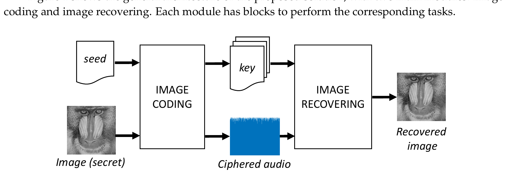{#fig-01 width=90%}

## Image Coding

Figure @fig-02 presents the block diagram of this module. Each block is explained as follows:

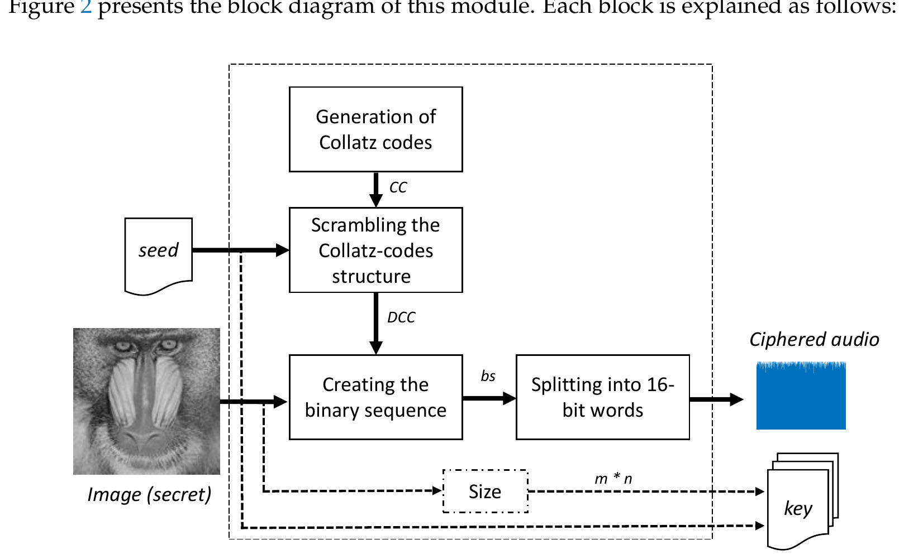{#fig-02 width=85%}

- **Collatz-code structure generation:** A total of $256$ codes are obtained according to the Collatz conjecture for integers $1$ to $256$. A code is formed by the parity bits (odd = `1`, even = `0`) of each iteration until the number reaches $1$. Every code starts with a header `11`. Figure @fig-03 illustrates an example for $x = 3$.

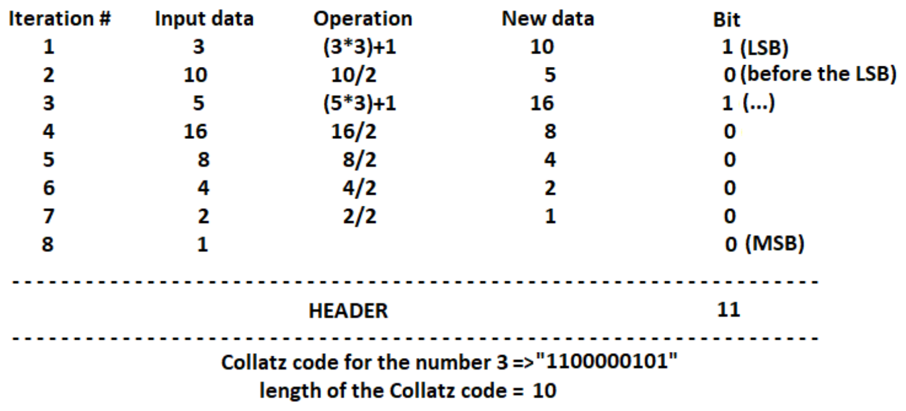{#fig-03 width=75%}

According to Figure @fig-03, a 10-bit Collatz code is obtained for $x = 3$. For $x = 4$, only three bits are obtained (`110`). The length of the code varies between $3$ and $130$ bits.

- **Shift pixel values by 1:** Since Collatz conjecture is defined for positive integers, the pixel values in $[0, 255]$ are shifted to $[1, 256]$ by adding $1$.
- **Scrambling the Collatz-code structure:** A permutation of the $256$ Collatz codes is performed using a secret key (seed), resulting in the Disordered Collatz Codes (DCC).
- **Transform image into a 1D sequence:** The 2D image matrix of size $M \times N$ is converted into a 1D vector of length $L = M \times N$ by scanning row by row.
- **Search pixel into DCC:** Each pixel value is mapped to its corresponding code in the scrambled structure DCC.
- **Assemble the binary sequence ($bs$):** The variable-length codes are concatenated alternately at the front and back of the bitstream, as illustrated in Figure @fig-04.

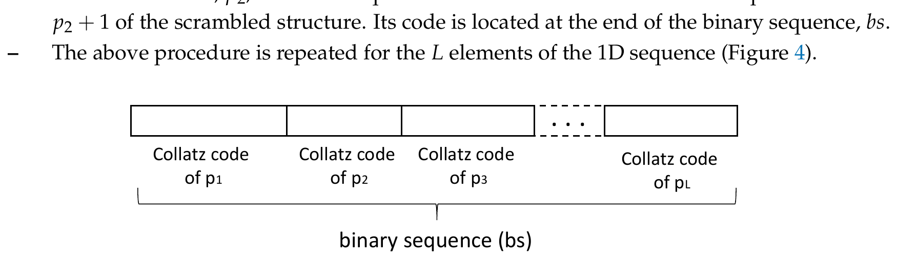{#fig-04 width=80%}

- **Convert binary sequence into audio file:** The bitstream $bs$ is grouped into 16-bit words, converted to decimal values, normalized to the range $[-1, 1]$, and saved as an uncompressed WAV audio file ($44.1$ kHz sampling frequency, 16 bits per sample).

## Image Recovering

Figure @fig-05 shows the block diagram of the recovering module.

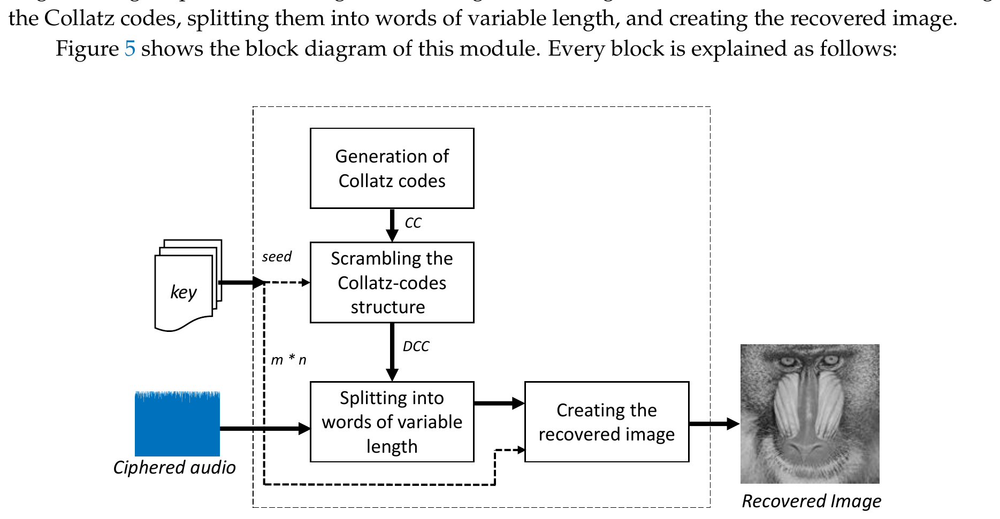{#fig-05 width=85%}

Each block performs the inverse operation:

- The encrypted audio file is read and converted back into the binary sequence $bs$.
- With the key (seed) and image size ($M \times N$), the authorized receiver regenerates the identical DCC structure.
- By searching for the header `11` and comparing the bit sequences against DCC, the pixel values are decoded in order.
- The 1D sequence is rearranged back into the original 2D image matrix of size $M \times N$, and pixel values are shifted back by subtracting $1$.

---

# Simulation Results

The proposed method was tested with several standard benchmark images of size $256 \times 256$, including Lena, Airplane, Baboon, and other natural images. Figure @fig-06 shows the original images, the resulting ciphered audio signals, and the recovered images.

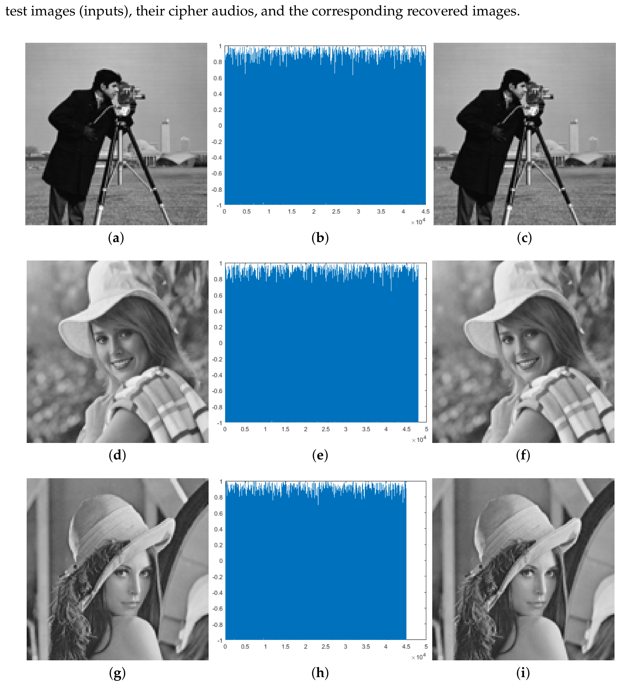{#fig-06 width=90%}

Perceptual similarity between original and recovered images is complete ($	ext{SSIM} = 1.0000$), confirming that the decryption process is fully lossless.

Next, Figure @fig-07 plots the histograms of the original images and their corresponding ciphered audio signals.

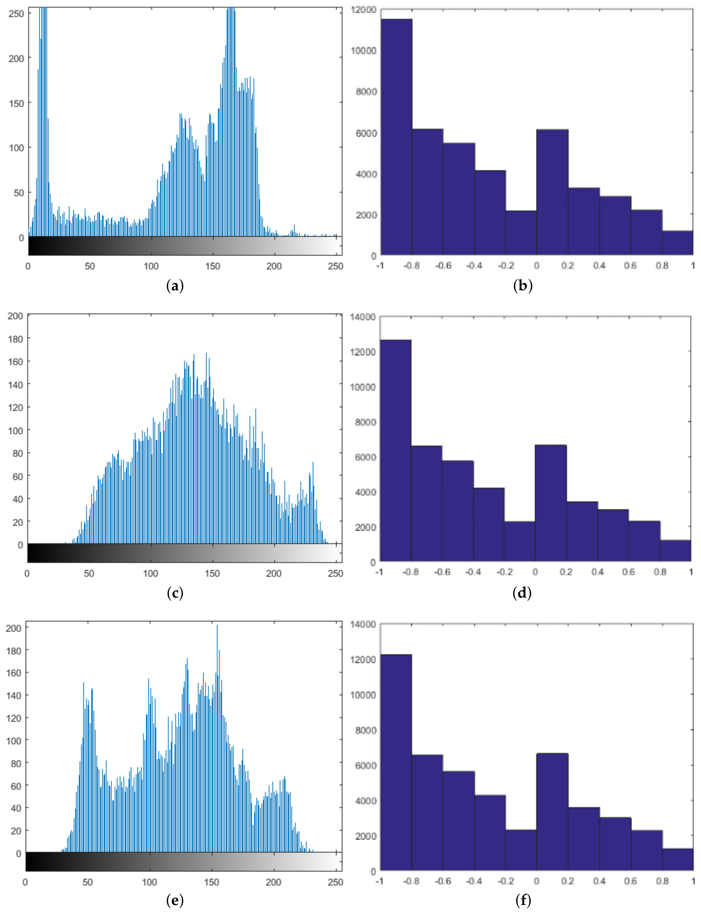{#fig-07 width=90%}

While the histograms of the plain images have distinctive unimodal or multimodal distributions, the histograms of the ciphered audio signals are uniformly distributed across the amplitude range $[-1, 1]$, masking any statistical trace of the plain images.

---

# Security Analysis

## Security Key Analysis

### Size of the Key Space

The proposed method uses a key to scramble the $256$ Collatz codes. The total number of permutations of $256$ elements is:

$$
|K| = 256! \approx 8.57 \times 10^{506} \approx 2^{1684}
$$ {#eq-keyspace}

According to Shannon's theory, unconditional security is achieved when the size of the key space is equal to or greater than the message space:

$$
|K| = |M| = |C|
$$ {#eq-shannon}

Figure @fig-08 illustrates this concept within the proposal.

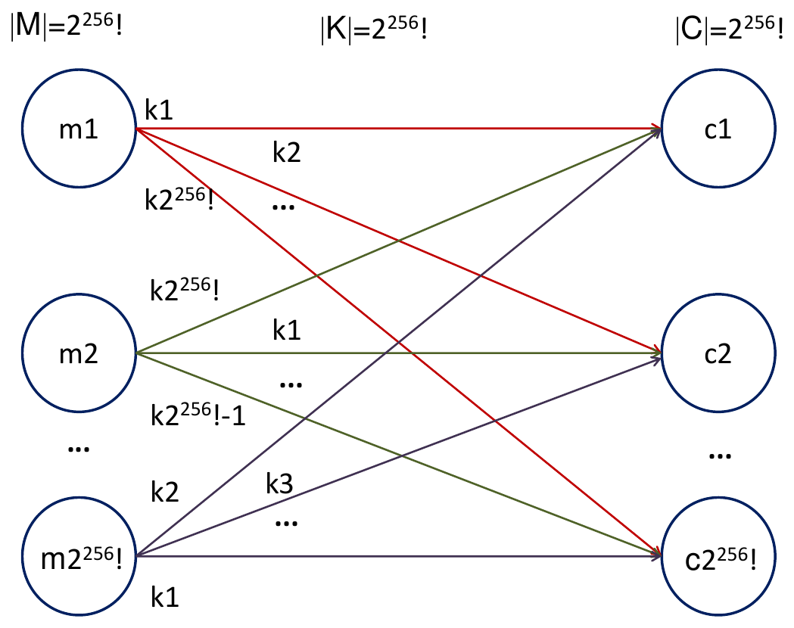{#fig-08 width=65%}

Because $|K| \approx 8.57 \times 10^{506} \gg 2^{128}$, the key space is sufficiently large to resist brute-force attacks.

### Key Sensitivity Analysis

To verify key sensitivity, an encrypted audio signal obtained with key $K_1$ was deciphered using a slightly modified key $K_2$. As shown in Figure @fig-09, the recovered output displays complete noise with no visual correlation to the original image ($	ext{SSIM} \approx 0.00$).

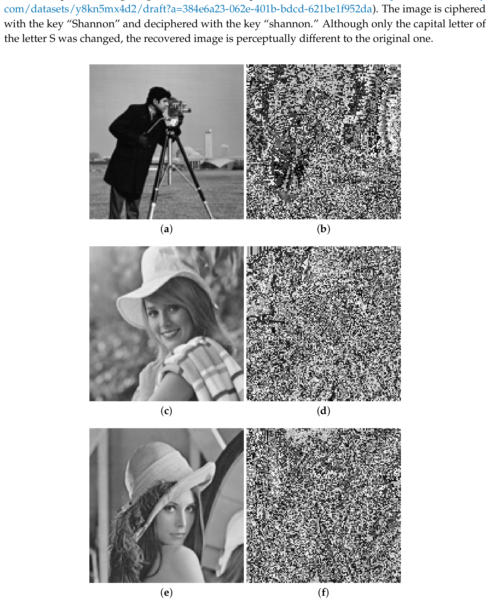{#fig-09 width=90%}

## Sensitivity to the Changes of Plain Image

The sensitivity to changes in the plain image was evaluated using the Unified Average Changing Intensity (UACI) adapted to the binary sequence $bs$:

$$
\text{UACI} = \frac{\sum |C_1 - C_2|}{L} \times 100
$$ {#eq-uaci}

where $C_1$ and $C_2$ are the binary sequences corresponding to two plain images differing by only one bit, and $L$ is the total length. Across $100$ tests, the UACI value was found to be between $0.44$ and $0.46$ ($44\%$ to $46\%$) with a $95\%$ confidence interval.

## Data Correlation Analysis

Figure @fig-10 presents scatter plots of horizontally adjacent pixels in the plain images alongside adjacent audio samples in the ciphered signals.

::: {#fig-10 layout-nrow=2}
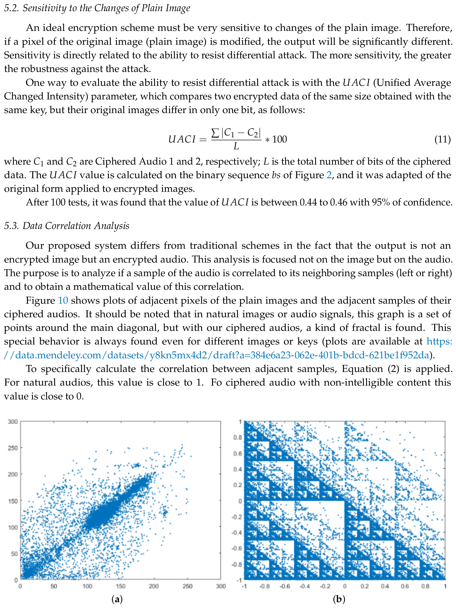{#fig-10a width=90%}

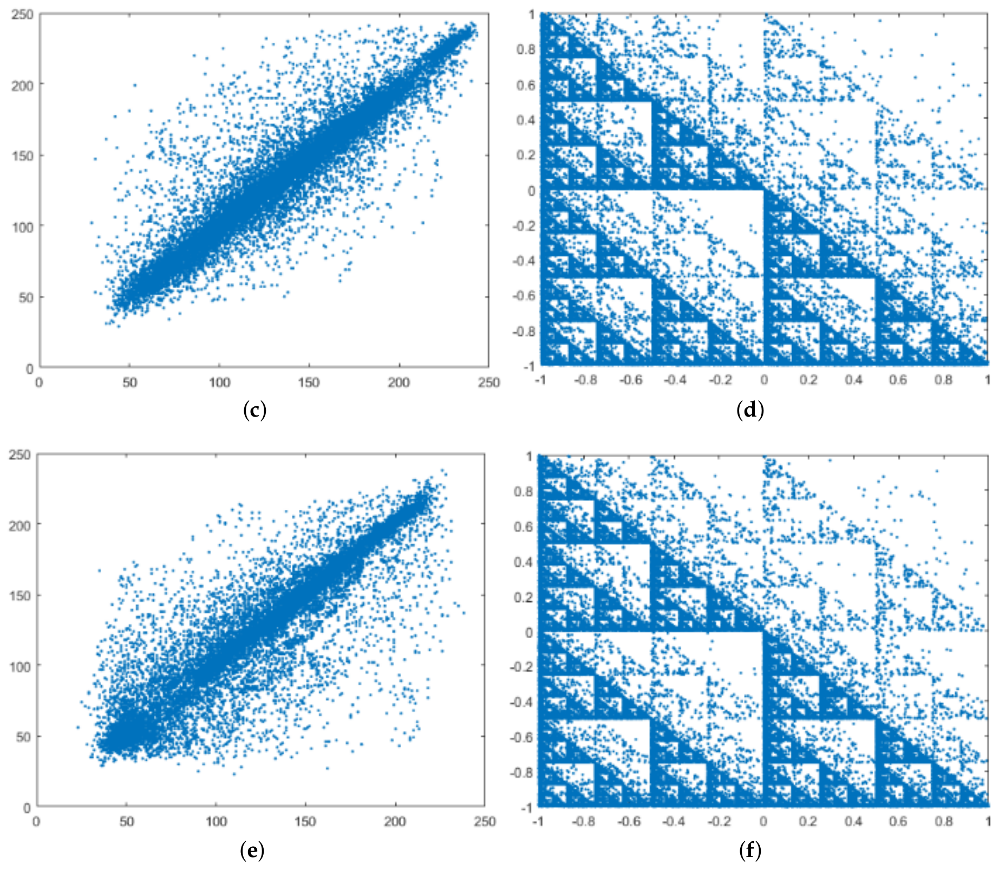{#fig-10b width=90%}

Distribution of horizontal adjacent pixels of plain images vs adjacent samples of cipher audio signals.
:::

The strong linear correlation in plain images ($r \approx 0.95$–$0.98$) disappears in the ciphered audio ($r \approx 0.00$), exhibiting an interesting fractal pattern.

## Uncertainty and Disorder Analysis

The information entropy and Disorder Scrambling (DS) metrics were computed across $100$ encrypted audio signals. Figure @fig-11 shows the radar plot of entropy values, which are consistently between $13.5$ and $14.0$ bits/sample (relative entropy $\approx 87.5\%$ of the theoretical maximum 16 bits). Figure @fig-12 shows the radar plot of DS values, ranging between $0.8$ and $1.4$.

::: {#fig-radar-analysis layout-ncol=2}
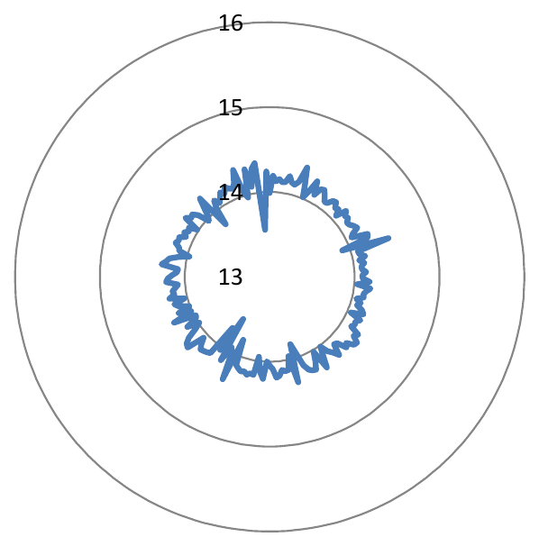{#fig-11 width=80%}

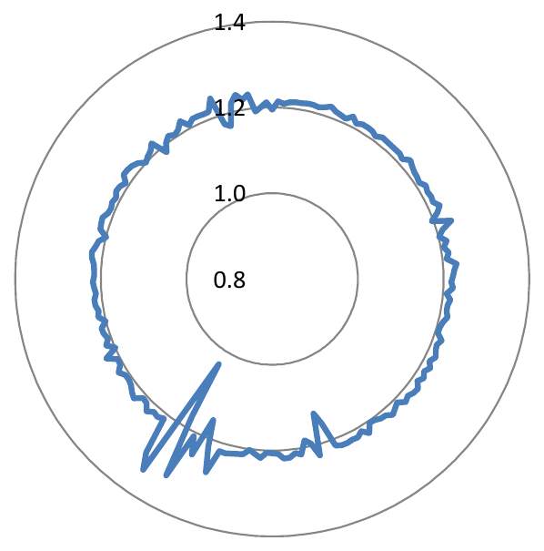{#fig-12 width=80%}

Statistical randomness and disorder across 100 ciphered signals.
:::

---

# Comparison with State-of-the-Art Methods

Table @tbl-comparison summarizes the comparison between the proposed Collatz-based encryption scheme and other recent image encryption methods from the literature.

| Reference | Method | Size of the Key Space | Key Sensitivity | Relative Entropy | UACI |
|:---|:---|:---:|:---:|:---:|:---:|
| [34] | Chaotic maps | $10^{56}$ | Very high | 99.8% | 0.5 (binary) / 0.33 (gray-scale) |
| [35] | Chaotic maps | $2^{256} \approx 1.1 \times 10^{77}$ | Very high | 99.7% | 0.33 |
| [36] | DNA encoding + chaos | $10^{93}$ | Very high | 99.8% | 0.33 |
| [37] | Chaotic maps | $10^{210}$ | Very high | 99.8% | 0.33 |
| [38] | DNA encoding + chaos | $3.4 \times 10^{38}$ | Very high | 99.9% | 0.33 |
| **Ours** | **Collatz encoding** | **$8.57 \times 10^{506}$** | **Very high** | **87.5%** | **0.44** |

: Performance comparison of some methods of image encryption. {#tbl-comparison}

---

# Conclusion

Most of the state-of-the-art image encryption methods have reached the quasi-maximal value of entropy in the encrypted data, which is an excellent characteristic of this kind of systems. However, as far as we know, none of those methods have satisfied the principle of perfect secrecy of Shannon, which claims that a system is unconditionally secure if the size of the key space is equal to the size of the message space; for this reason, it is expected that in the near future those methods can be broken.

In this paper, we have proposed an image encryption scheme that differs from recent state-of-the-art methods in the way to obtain the encrypted data; we have combined the diffusion and confusion tasks by means of a variable length coding of the pixels based on the Collatz conjecture, and not by chaotic sequences. Our proposal satisfies the principle of secure secrecy of Shannon's theory, which means our system is the most robust scheme against brute force and differential attacks of the state-of-the-art methods. One aspect to improve in our method lies in the entropy value of the encrypted data. However, the behavior of the original data is completely modified in its encrypted version, which can be verified, for instance, by looking at the histograms and the plots of adjacent data. Regarding this last point, fractal behavior has been found in the encrypted data, which is a distinctive pattern of our method.

According to the above analysis, we propose the following themes for future work:

- Identify weaknesses of our proposal in terms of the probability of the available space (theoretical it is equally likely) and what can affect the robustness against brute force attack and differential attack. This is related to the way to randomize the Collatz codes. For that purpose, three pairs of original images and encrypted data are available at [https://data.mendeley.com/datasets/y8kn5mx4d2/draft](https://data.mendeley.com/datasets/y8kn5mx4d2/draft?a=384e6a23-062e-401b-bdcd-621be1f952da).
- Apply bit scrambling to the binary sequence, $bs$, of Figure @fig-02 with the purpose of increasing the entropy of the encrypted data.
- Explore other choices of image coding based on the Collatz conjecture. For example, applying the Collatz code not for the pixel value but for the pixel position. Analyze the performance of the system in terms of security.

---

**Author Contributions:** Conceptualization, D.R.; Formal analysis, D.M.B.; Investigation, D.M.B.; Methodology, D.R.; Software, J.P.; Validation, J.P.; Writing—original draft, D.M.B. and J.P.; Writing—review & editing, D.R.

**Funding:** This work was supported by the "Universidad Militar Nueva Granada-Vicerrectoría de Investigaciones" under the grant IMP-ING-2136 of 2016.

**Conflicts of Interest:** The authors declare no conflict of interest.

---

# References

1. Faragallah, O.S.; El-Samie, F.E.A.; Ahmed, H.E.H.; Elashry, I.F.; Shahieen, M.H.; El-Rabaie, E.S.M.; Alshebeili, S.A. *Image Encryption: A Communication Perspective*; CRC Press: Boca Raton, FL, USA, 2013.
2. Pareek, N.K.; Patidar, V.; Sud, K.K. Diffusion–substitution based gray image encryption scheme. *Digit. Signal Process.* **2013**, *23*, 894–901.
3. Zhang, X.; Wang, X. Multiple-image encryption algorithm based on mixed image element and permutation. *Opt. Lasers Eng.* **2017**, *92*, 6–16.
4. Zhu, H.; Zhang, X.; Yu, H.; Zhao, C.; Zhu, Z. A Novel Image Encryption Scheme Using the Composite Discrete Chaotic System. *Entropy* **2016**, *18*, 276.
5. Silva-García, V.; Flores-Carapia, R.; Rentería-Márquez, C.; Luna-Benoso, B.; Aldape-Pérez, M. Substitution box generation using Chaos: An image encryption application. *Appl. Math. Comput.* **2018**, *332*, 123–135.
6. Wang, X.Y.; Zhang, Y.Q.; Bao, X.M. A Colour Image Encryption Scheme Using Permutation-Substitution Based on Chaos. *Entropy* **2015**, *17*, 3877–3897.
7. Ye, G. Image scrambling encryption algorithm of pixel bit based on chaos map. *Pattern Recognit. Lett.* **2010**, *31*, 347–354.
8. Huang, X. Image encryption algorithm using chaotic Chebyshev generator. *Nonlinear Dynam.* **2011**, *67*, 2411–2417.
9. Wang, X.; Teng, L.; Qin, X. A novel colour image encryption algorithm based on chaos. *Signal Process.* **2012**, *92*, 1101–1108.
10. Zhou, Y.; Bao, L.; Chen, C.P. A new 1D chaotic system for image encryption. *Signal Process.* **2014**, *97*, 172–182.
11. Ye, G.; Huang, X. An Image Encryption Algorithm Based on Autoblocking and Electrocardiography. *IEEE MultiMedia* **2016**, *23*, 64–71.
12. Pak, C.; Huang, L. A new color image encryption using combination of the 1D chaotic map. *Signal Process.* **2017**, *138*, 129–137.
13. Tu, G.; Liao, X.; Xiang, T. Cryptanalysis of a color image encryption algorithm based on chaos. *Optik* **2013**, *124*, 5411–5415.
14. Wang, X.; Luan, D.; Bao, X. Cryptanalysis of an image encryption algorithm using Chebyshev generator. *Digit. Signal Process.* **2014**, *25*, 244–247.
15. Dhall, S.; Pal, S.K.; Sharma, K. Cryptanalysis of image encryption scheme based on a new 1D chaotic system. *Signal Process.* **2018**, *146*, 22–32.
16. Wang, H.; Xiao, D.; Chen, X.; Huang, H. Cryptanalysis and enhancements of image encryption using combination of the 1D chaotic map. *Signal Process.* **2018**, *144*, 444–452.
17. Li, C.; Lin, D.; Lu, J. Cryptanalyzing an Image-Scrambling Encryption Algorithm of Pixel Bits. *IEEE MultiMedia* **2017**, *24*, 64–71.
18. Li, C.; Lin, D.; Lu, J.; Hao, F. Cryptanalyzing an image encryption algorithm based on autoblocking and electrocardiography. *IEEE MultiMedia* **2018**, *25*, 108–112.
19. Xie, E.Y.; Li, C.; Yu, S.; Lu, J. On the cryptanalysis of Fridrich's chaotic image encryption scheme. *Signal Process.* **2017**, *132*, 150–154.
20. Chai, X.; Chen, Y.; Broyde, L. A novel chaos-based image encryption algorithm using DNA sequence operations. *Opt. Lasers Eng.* **2017**, *88*, 197–213.
21. Jain, A.; Rajpal, N. A robust image encryption algorithm resistant to attacks using DNA and chaotic logistic maps. *Multimed. Tools Appl.* **2015**, *75*, 5455–5472.
22. Hermassi, H.; Rhouma, R.; Belghith, S. Cryptanalysis of an image cipher with permutation-diffusion rounds based on chaos and DNA operations. *Multimed. Tools Appl.* **2016**, *75*, 3871–3883.
23. Wang, X.; Luan, D. A novel image encryption algorithm using chaos and reversible cellular automata. *Commun. Nonlinear Sci. Numer. Simul.* **2013**, *18*, 3075–3085.
24. Sui, L.; Gao, B. Single-channel color image encryption based on iterative fractional Fourier transform and 3D Lorenz chaotic system. *Opt. Lasers Eng.* **2013**, *51*, 1297–1309.
25. Fu, C.; Lin, B.B.; Yusof, Y.S.M.; Liang, P. An image encryption scheme based on simultaneous permutation and diffusion. *Nonlinear Dynam.* **2018**, *94*, 1923–1936.
26. Chamberland, M. A continuous extension of the 3x + 1 problem to the real line. *Dyn. Contin. Discrete Impuls. Syst.* **2003**, *10*, 431–440.
27. Lagarias, J.C. The 3x + 1 problem and its generalizations. *Am. Math. Mon.* **1985**, *92*, 3–23.
28. Ballesteros, D.M.; Renza, D. Speech Scrambling in the Audio Spectrum by Using Shift-Inversion Operations. *Ing. Invest.* **2017**, *37*, 86–94.
29. Wang, Z.; Bovik, A.C.; Sheikh, H.R.; Simoncelli, E.P. Image quality assessment: From error visibility to structural similarity. *IEEE Trans. Image Process.* **2004**, *13*, 600–612.
30. Dosselmann, R.; Yang, X.D. A comprehensive assessment of the structural similarity index. *Signal Image Video Process.* **2011**, *5*, 81–91.
31. Renza, D.; Ballesteros, D.M. Chaos-based Speech Scrambling via 1D Chaotic Maps. *Rev. Fac. Ing. Univ. Antioquia* **2018**, *87*, 58–66.
32. Sadkhan, S.B.; Abbas, N.A. Proposed modification of voice scrambling system using chaotic map. *Al-Mansour J.* **2009**, *12*, 1–14.
33. Shannon, C.E. Communication theory of secrecy systems. *Bell Syst. Tech. J.* **1949**, *28*, 656–715.
34. Hua, Z.; Zhou, Y.; Pun, C.M.; Chen, C.P. 2D Sine Logistic modulation map for image encryption. *Inf. Sci.* **2014**, *297*, 80–94.
35. Wu, X.; Wang, K.; Wang, X.; Kan, H.; Kurths, J. Color image DNA encryption using NCA map-based CML and one-time keys. *Signal Process.* **2018**, *148*, 272–287.
36. Enayatifar, R.; Abdullah, A.H.; Isnin, I.F.; Altameem, A.; Lee, M. Image encryption using a novel Sous-le-bois map and DNA approach. *Inf. Sci.* **2017**, *418*, 421–444.
37. Xu, L.; Gou, X.; Li, Z.; Li, J. A novel chaotic image encryption scheme using combined linear-nonlinear coupled map lattices. *J. Comput. Appl. Math.* **2017**, *318*, 462–478.
38. Zhen, P.; Zhao, G.; Min, L.; Jin, X. Chaos-based image encryption scheme combining DNA coding and entropy. *Multimed. Tools Appl.* **2016**, *75*, 6303–6319.
